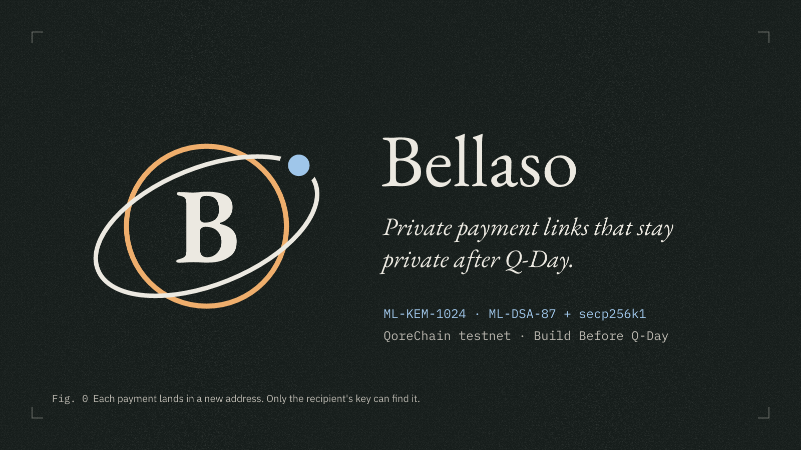
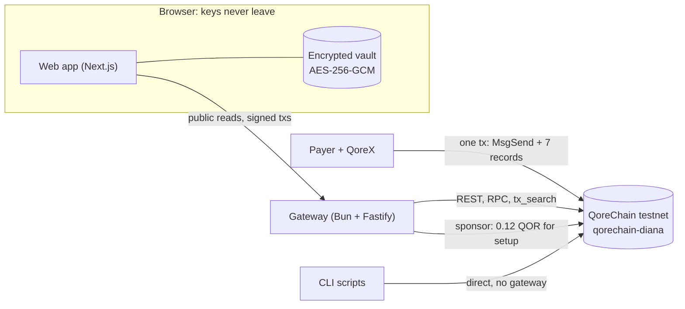

# Bellaso



Private payment links that stay private after Q-Day.

Bellaso hides the recipient of a payment with ML-KEM-1024 and protects the funds with a hybrid secp256k1 + ML-DSA-87 signature. All secret keys stay in the browser or the CLI of the user. It runs on the QoreChain testnet `qorechain-diana`. Entry for the QoreChain "Build Before Q-Day" fest, category Encrypted Apps.

## The problem

Stealth payments today (Umbra, Fluidkey, BIP-352 Silent Payments) hide the recipient with elliptic-curve Diffie-Hellman. Each payment leaves a record on chain, and the chain keeps every record. A quantum computer can break that math later and match every old payment to its recipient. L2BEAT rates ECDH stealth payments "Exposed" to a future adversary. A privacy leak cannot be reversed by a fork.

## The design

Bellaso keeps the stealth-address idea and replaces each elliptic-curve secret with a post-quantum one.

- **Recipient hidden with ML-KEM-1024 (FIPS 203).** The payer's browser encapsulates a shared secret to the recipient's KEM key from the QoreSeal registry. The secret gives a new one-time address `P = P_A + h·G` with `h = SHAKE256("bellaso/v1/spend-tweak" ‖ ss) mod n`. Only the 1,568-byte ciphertext and a 1-byte view tag go on chain.
- **Funds spent with secp256k1 + ML-DSA-87 (FIPS 204).** The ML-DSA-87 key of each one-time address comes from the recovery phrase and the payment secret. The chain accepts a spend only when both signatures are valid (event `pqc_hybrid_verify`).
- **One transaction for the payer.** QoreX signs one native transaction: the transfer to the one-time address and the announcement as 7 base32768 records in our own instance of contract code 865.
- **No custody, no secret on a server.** The gateway relays public chain data and serves every announcement to every client. It cannot tell which payments are yours.

### Two ways to get paid

1. **Payment link.** One link for all payers. The payer opens it and pays with QoreX. Each payment still goes to a new address.
2. **Stealth address.** A new address for one client, derived from `h = SHAKE256(pqRoot ‖ i)`. The client pays from any wallet with a normal transfer. No announcement is needed.

### What stays hidden, and what does not

| Hidden, also after Q-Day | Public |
|---|---|
| The link between a payment and the recipient | The payer address, the amount and the token |
| The link between two payments to the same recipient | The time of the payment and of the spend |
| The funds: a spend needs both signatures | That a transaction is a Bellaso payment |

`docs/THREAT_MODEL.md` gives every risk and its limit.

### Architecture



- `apps/web`: create, pay, inbox, spend and get-paid pages. The inbox opens every announcement in the browser.
- `apps/gateway`: CORS relay with path and method allowlists, the announcement and transfer indexes, and the sponsor. It keeps no access log.
- `packages/core`: the cryptography and the formats, with fixed test vectors.
- `packages/chain`: network constants, the transaction reader and the `tx_search` client.
- `scripts`: the CLI. It reads the chain directly, so it checks the gateway independently.

## Live

| What | Where |
|---|---|
| Web app | https://bellaso.vercel.app |
| Pay page of the demo recipient | https://bellaso.vercel.app/pay/qor130jxjehyvf2ndr6lyutl9e09plv7k0epyhnmyz#k=b28fe7b8c9575ffb8d137581d33c2b2b |
| Gateway health | https://gateway-production-4e82893b.up.railway.app/v1/health |

To pay from a phone, open the pay page in the QoreX app's dApp browser with Settings › Use testnet (developers) on. The QoreX browser extension has no testnet switch.

Testnet `qorechain-diana` addresses:

| Role | Address |
|---|---|
| Announcement contract (own instance of code 865) | `qor17jq8wze2n9m02c6vtkle6uxr4xccq07e6gxc2np7zq78feuv7tnq2wpp8d` |
| Demo recipient made in the browser (funded only by the sponsor) | `qor130jxjehyvf2ndr6lyutl9e09plv7k0epyhnmyz` |
| CLI recipient, account A | `qor1j677x84lr8fr2u3x24z69snzxe6mgjt3zstnyf` |
| CLI payer | `qor1tlmlljsn39w5fhr5lypjsh5ksafwpddmps0umc` |
| Gateway sponsor | `qor1z2a42d9cj6vfcsprxlxq3f0peu5uyy2x5m43ga` |

## Evidence on testnet

All values are MEASURED on `qorechain-diana` in November 2026. `docs/PLAN.md` section 3 has the full list.

| Claim | Proof |
|---|---|
| Setup registers the ML-DSA-87 key with a proof of possession, and the KEM key with a hybrid signature, from the browser through the gateway | Sponsor `E034D4B3…0CB4`, signing key `BA34BD91…BC4E`, KEM key `73DF790A…10B2` (26 s in total) |
| One payment is one transaction with the transfer and the announcement, without the address of the recipient | QoreX payment `3D7BEDE9…FC72`; CLI payment `59CF3A20…9856` (838,518 gas, fee 0.19 QOR) |
| The spend has two signatures | Browser spend `F1BA9D65…B726` and stealth spend `372120AD…E830`, both with `pqc_hybrid_verify` |
| The scan finds every payment and no false positive | `scan.ts`: 13 announcements, 7 found for account A, 0 false positives |
| The gateway serves the same announcements as the chain | `scan.ts --source chain` and `--source gateway` give identical output |
| A third party with public data only cannot link a payment to the recipient | `link-attempt.ts` on the demo recipient: 0 matches for all five links to the recipient (H1 to H5) |
| A stealth address gets a normal QoreX Send, the inbox finds it, and it is spent with two signatures | QoreX Send `58C8C659…3793`, spend `2F433B8F…84F3` with `pqc_hybrid_verify`; `link-attempt` still finds no link |
| A stolen classical key moves nothing | `qday-drill.ts`: a native send, an EVM window, an EVM transfer, an ERC-20 transfer and an approve were all refused; the balances did not change |

## Run

Requirements: Bun 1.3.3 or later.

```sh
bun install
cp .env.example .env
bun run dev            # web app on http://localhost:3000
bun run gateway        # gateway on http://localhost:8080
bun run check          # typecheck, lint, test, build
```

CLI scripts (from the repository root; `bun scripts/keys.ts` writes test phrases to `.env` and prints only addresses):

```sh
bun scripts/setup.ts                          # register the keys of account A
bun scripts/records.ts --amount 5 --count 3   # pay account A with the CLI payer
bun scripts/scan.ts --source chain            # find the payments of account A
bun scripts/spend.ts <qor1 destination>       # spend one payment with two signatures
bun scripts/link-attempt.ts --account <qor1>  # try to link payments with public data only
```

## Documents

- `SPEC.md`: product decisions and acceptance criteria
- `docs/TECH_SPEC.md`: cryptography, formats, gateway, gates
- `docs/THREAT_MODEL.md`: what Bellaso protects and what it does not
- `docs/PLAN.md`: plan, backlog and gate evidence
- `docs/LANDSCAPE.md`: other projects, market and sources
- `PRODUCT.md`, `DESIGN.md`: product and design context

## Credits

- QoreChain kits: `@qorechain/sdk` (accounts, hybrid signing, PQC registration), `@qorechain/qoreseal` (ML-KEM-1024 and the KEM key registry), and the QoreX wallet.
- Stealth address designs that came first: ERC-5564 and ERC-8441, Umbra, Fluidkey, Squidl and Specter, BIP-352 Silent Payments.
- Giovan Battista Bellaso, who published a keyed cipher in 1553. History gave the credit to Vigenère.

## Licence

Apache-2.0. See `LICENSE`.
